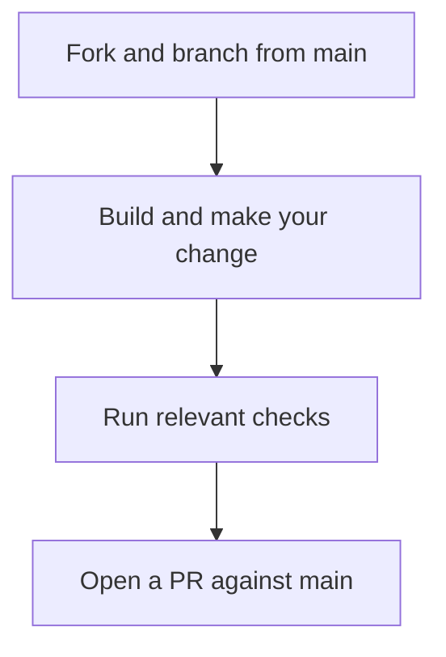

# Contributing to GlideTV

GlideTV is a lightweight, native Android TV launcher. Contributions from outside the project are welcome: bug fixes, accessibility, documentation, translations and scene packs.

## Report a bug

[Open a structured bug report](https://github.com/ghanta1996/GlideTV/issues/new?template=bug.yml) with:

- TV model, Android/Google TV version and Glide version.
- Steps to reproduce, expected behavior and what happened instead.
- A screenshot or short recording for display/focus problems, with private information removed.
- Relevant logs, if available. Remove tokens, pairing codes, network addresses and viewing history.

For a feature or larger redesign, use the [feature request form](https://github.com/ghanta1996/GlideTV/issues/new?template=feature.yml) to explain the problem, benefit, proposed behavior and acceptance criteria before implementation.

## Make a change

Use the [developer guide](docs/DEVELOPMENT.md) for local builds. Keep changes focused and preserve D-pad navigation, readable TV text and existing preferences. In the PR, explain the result, link related issues and list checks you ran.

Code changes must increase both `versionName` and `versionCode` in `AndroidManifest.xml` and add a matching entry to `CHANGELOG.md`. CI checks this before releasing automatically from `main`. Documentation-only changes need no version bump. See the [release rules](docs/DEVELOPMENT.md#build-and-release).

## Show visible changes

Attach **before/after screenshots or a short screen recording in the PR description**. Capture the running app on an emulator or TV; mockups are useful for proposals but do not verify an implementation.

Show relevant focus states, transitions and empty states. Include the tested commit, Android version, screen resolution and whether demo data was used. For launcher interactions, verify remote/D-pad navigation as well as appearance. See [capture instructions](docs/DEVELOPMENT.md#visual-review-captures).

## Validation reference

| Change | Useful checks |
| --- | --- |
| Native launcher | `bash build.sh`, relevant runtime checks on Android TV |
| Icon colors | `bash scripts/test-icon-palette.sh` |
| APK download handling | `bash scripts/test-downloads.sh` |
| Version policy and release tooling | `python3 scripts/test_version.py`, `python3 scripts/test_release.py` |
| Adaptive readability | `bash scripts/test-readability.sh` |
| Documentation | Check links and preview diagrams/images |

## Test matrix

Choose the smallest matrix that covers the changed behavior and report exactly what ran.

| Change | Minimum coverage |
| --- | --- |
| Build, parsing or release policy | Local automated checks plus required GitHub checks |
| Launcher navigation or focus | Android TV emulator or device with D-pad verification |
| Responsive or visual layout | Actual 720p, 1080p and 4K captures from the CI artifact |
| Scenery, glass or text readability | Light and dark scenery, relevant focus states and the transition recording |
| Permissions, network, installation or playback metadata | A compatible real device when the emulator cannot provide the platform service; document unavailable coverage |

Do not include account data or personal viewing information in test fixtures. Prefer the repository's synthetic demo apps and seeded Continue Watching data.

If you could not run a check, say so and explain the limitation. Do not describe an untested result as verified.

## Scene contributions

Follow the [scene pack guide](scenes/README.md). Include artwork provenance and permission to redistribute it, keep packs small, and update the scene changelog. Never replace the contents of an already published pack version.

## Attribution and review

Disclose substantive AI-generated implementation in the PR description and preserve co-author trailers when squashing. Codex-specific attribution and visual-review requirements are in [AGENTS.md](AGENTS.md). A co-author credit does not require collaborator access.

Maintainers review and merge changes and handle official releases. Development APKs use a different signing key and cannot replace the official app in place. Contributions are provided under the repository's [MIT license](LICENSE); do not submit third-party code or artwork without a compatible license.
