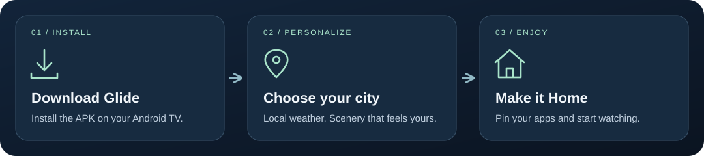
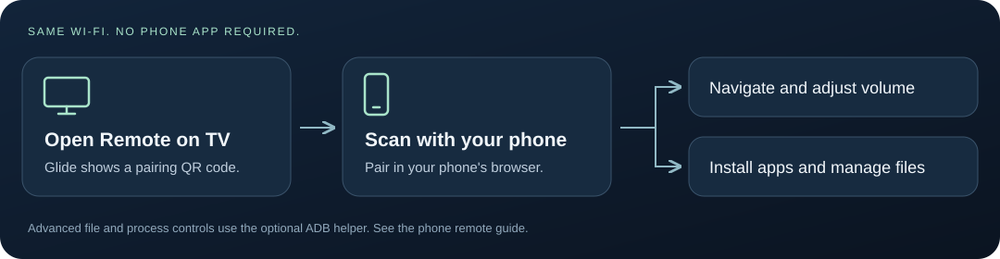

# Glide TV

### Your TV. Beautifully simple.

A lightweight home for Android TV and Google TV, with living scenery, favorite apps and control from your phone.

[**Download APK**](https://github.com/ghanta1996/GlideTV/releases/latest) · [Setup guide](docs/DEFAULT_HOME.md) · [What's new](CHANGELOG.md)

*Optional Abu Dhabi scenery. Choose your own location during setup.*

## Make it yours

- **Living scenery** that follows weather and daylight, with downloaded artwork cached for offline use.
- **Your apps, one dock** with favorites, icon-based colors and Continue Watching from supported apps.
- **Your phone, a remote** for navigation, volume and app installation.

## Get started

Requires **Android TV / Google TV 8.0+**. Default-Home support depends on your TV's firmware. Follow the [setup guide](docs/DEFAULT_HOME.md) for TV settings, ADB options and restoring your original launcher.

## Control it from your phone

[Phone remote guide](docs/REMOTE.md) · [Installation and updates](docs/INSTALLATION.md)

## Contribute

Bug fixes, translations, accessibility improvements and new scenery are welcome. Read [CONTRIBUTING.md](CONTRIBUTING.md) for reporting issues, building Glide and submitting a pull request. Visual changes need screenshots or a recording.

[Developer guide](docs/DEVELOPMENT.md) · [Scene packs](scenes/README.md)

## Credits

[MIT license](LICENSE). Built with [ZXing](lib/ZXING-LICENSE.txt), Open-Meteo/CAMS weather and air-quality data, and GeoNames-backed city search. App logos belong to their owners; those apps are not included. [Artwork provenance](assets/live/).
