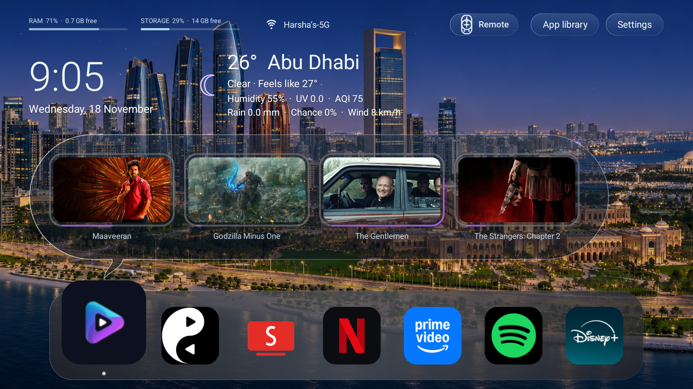

# Glide TV

A lightweight home for Android TV and Google TV, with living scenery, favorite apps and control from your phone.

[**Download APK**](https://github.com/ghanta1996/GlideTV/releases/latest) · [Setup guide](docs/DEFAULT_HOME.md) · [What's new](CHANGELOG.md)

**Downloader code: `3583851`** · [Short download link](https://aftv.news/3583851)

*Optional Abu Dhabi scenery. Choose your own location during setup.*

## Get started

Requires **Android TV / Google TV 8.0+**. Default-Home support depends on your TV's firmware. Follow the [setup guide](docs/DEFAULT_HOME.md) for TV settings, ADB options and restoring your original launcher.

## Control it from your phone

[Phone remote guide](docs/REMOTE.md) · [Installation and updates](docs/INSTALLATION.md)

## Music playback info

Glide can optionally show the active media title, artist, album and artwork on Home. Enable it from **Settings → Music playback info**. Android notification access is required to discover media sessions; Glide does not add playback controls, retain listening history or upload this metadata. Support depends on the media app and TV firmware.

## Contribute

[Contribution guide](CONTRIBUTING.md) · [Developer guide](docs/DEVELOPMENT.md) · [Scene packs](scenes/README.md)

## Credits

[MIT license](LICENSE). Built with [ZXing](lib/ZXING-LICENSE.txt), Open-Meteo/CAMS weather and air-quality data, and GeoNames-backed city search. App logos belong to their owners; those apps are not included. [Artwork provenance](assets/live/).
