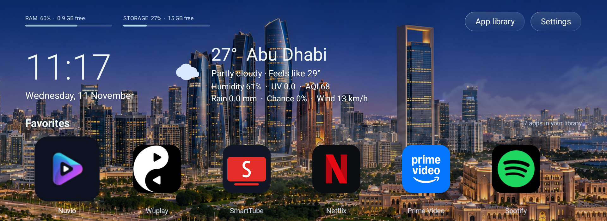
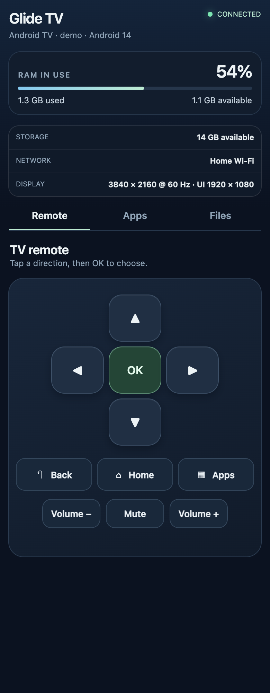
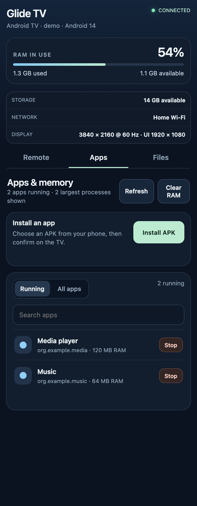

# Glide TV

### Your TV. Beautifully simple.

A clean home for Android TV, with living scenery, your favorite apps, and control from your phone.

[Download Glide](https://github.com/ghanta1996/GlideTV/releases/latest) · [Make it your Home](docs/DEFAULT_HOME.md) · [What's new](CHANGELOG.md) · [Release builds](https://github.com/ghanta1996/GlideTV/actions/workflows/release.yml)



*An example of Glide with the optional Abu Dhabi Skyline pack. Your location is chosen during setup; this scene is not the default for everyone. Capture cropped above Continue Watching to keep viewing history private.*

## A home that feels yours

**A view that stays alive.** Scenery moves gently with weather and daylight. Choose your city or use the TV's location during setup; Glide downloads a matching scene pack from GitHub. A native landscape fills in wherever a dedicated city scene isn't available.

**Your apps, front and center.** Big icons, quick favorites, a separate app library, and Continue Watching that follows the highlighted app. Watch history appears when the media app shares it with Android TV.

**Your phone is a remote.** Scan to pair, navigate the TV, adjust volume, browse storage, send files, manage running apps, or install an APK from your phone with confirmation on the TV.

**Light from the start.** Artwork is downloaded separately and cached for offline use. The native Java launcher bundles no scene imagery and needs no video for the default live scenery. RAM/storage meters and connection shortcuts keep useful TV information close.

## From the sofa to your phone

<p>
  
  
</p>

*Browser screenshots use demo device data.*

## Get started

Glide runs on Android TV / Google TV with Android 8.0 (API 26) or newer. Replacement-Home behavior depends on the TV's firmware.

1. Download the APK from [Releases](https://github.com/ghanta1996/GlideTV/releases/latest) and sideload it using your preferred installer, or ADB:

   ```sh
   adb -s <adb-serial> install -r GlideTV-v4.4.0.apk
   ```

2. Open Glide. Choose **Use device location** or **Search city**. If the TV cannot provide a location, city/postal-code search works worldwide. Downloading scenes and fetching weather require internet access.
3. Follow the complete [default-Home guide](docs/DEFAULT_HOME.md). It covers TV settings, wireless ADB, saving the original launcher, selecting Glide, testing Home, firmware restrictions, and restoring the original Home.
4. Pin your favorite apps from the library. Existing saved favorites and supported older location settings are preserved during an update.

The app may request Android location, TV listings/Watch Next, and Bluetooth connection access. Location is optional; searching for a city does not require device-location permission. Coordinates determine local weather, air quality, time zone, sunrise, and sunset. Weather includes temperature, feels-like, humidity, UV, precipitation, rain chance, wind, and US AQI.

## Scenes that travel light

Scene packs have independent versions and a [separate changelog](scenes/CHANGELOG.md). Only the selected pack is downloaded. Pack downloads are checksummed and cached; the launcher also has a native fallback before download. City-specific coverage is currently available for Abu Dhabi, with a generic landscape everywhere else. More packs can be added without an APK update.

See [scene pack documentation](scenes/README.md) for supported artwork, coverage, versioning, and contributing a new scene. The artwork is an artistic backdrop, not a live camera feed or a guarantee of an exact view of the user's city.

## Mobile control and app installation

Open **Remote** on Glide Home, or **Settings → Mobile control**, and scan the QR while your phone is on the same network. The address/code are also displayed. The dots-only QR uses light-on-dark colors; scanners without inverted-code support can use the address and code.

Pairing closes the TV dialog and turns the Remote indicator green. The browser shows TV status, apps, and shared files. Choose **Apps → Install APK**, select a file on your phone, and confirm installation on the TV. If Android asks you to allow Glide to install apps, enable that setting and use **Retry installation** in the browser.

TV-wide process management, shared-storage browsing/transfers, and global key input require the optional ADB helper below. Uploads go to `Download/Glide Remote`, do not overwrite existing files, and are limited to 2 GB each. Android private app directories remain inaccessible.

The local server uses temporary PIN pairing and a bearer session over HTTP on the TV's subnet. Use a trusted private network and do not expose the ports to the internet. PINs expire after ten minutes, sessions after thirty minutes, and paired remotes stop after five minutes without an action. Status polling does not keep the session alive. **Turn off** closes the server manually.

## Optional ADB helper

The helper runs as a debugging-shell process on `127.0.0.1`, authenticates with a random app-generated token, and offers fixed operations rather than arbitrary shell commands.

Open Glide and its RAM dialog or Remote once to create the token. After building from source:

```sh
./start-memory-helper.sh <adb-serial>
```

Or download `glide-memory-helper.dex` from the same release, download the source scripts, and use:

```sh
GLIDE_HELPER_DEX=/path/to/glide-memory-helper.dex ./start-memory-helper.sh <adb-serial>
```

The helper script requires zsh and ADB. Restart the helper after a TV reboot. Android can reclaim memory after a cleanup; free RAM is not a persistent reservation.

## Updates

Choose **Settings → Check for updates**. Glide checks the latest stable public APK, downloads over HTTPS, verifies its checksum and package/version, then opens Android's installation confirmation. Android enforces the signing identity; normal upgrades preserve your settings. Checks are manual.

Android may evict Glide while another app is active. Reopen Home and start Remote to make the browser connection available again.

## Build and release

Requires Bash, JDK 17, Android SDK platform 36, build-tools 35.0.0, and standard zip/JDK tools. ZXing Core is vendored under `lib/`.

```sh
export JAVA_HOME=/path/to/jdk-17
export ANDROID_SDK_ROOT=/path/to/android-sdk
./build.sh
```

Outputs: `build/GlideTV.apk` and `build/bridge-dex/classes.dex`. The build recognizes the development machine's Homebrew defaults on macOS. Local builds generate an ignored development keystore if needed. For your own releases, provide `GLIDE_KEYSTORE`, `GLIDE_KEYSTORE_PASSWORD`, `GLIDE_KEY_PASSWORD`, and `GLIDE_KEY_ALIAS`. Keep the same signing key for upgrades; a separately signed fork cannot replace an official build.

The [APK workflow](.github/workflows/release.yml) publishes a signed APK, helper, checksums, `update.json`, current scene packs, and the scene catalogue. The [scene workflow](.github/workflows/scenes.yml) publishes packs independently. Both require a changelog entry and derive release notes from it.

Maintainers configure `GLIDE_KEYSTORE_BASE64`, `GLIDE_KEYSTORE_PASSWORD`, `GLIDE_KEY_PASSWORD`, and `GLIDE_KEY_ALIAS` as repository secrets. The signing key is never committed; CI fails if it is missing.

For an app release, increase the Android version code, set `versionName`, update [CHANGELOG.md](CHANGELOG.md), and push a matching `v<versionName>` tag. For a scene release, update the catalogue/pack versions and [scene changelog](scenes/CHANGELOG.md), then push `scene-v<catalogVersion>`. Published pack content cannot change under an existing version. Manual workflow dispatch supports rebuilding an existing tag.

Forks should update the repository URLs in the updater, scene downloader, and release scripts and use their own release key.

## Credits and license

[MIT license](LICENSE). ZXing Core uses Apache 2.0, included in [`lib/ZXING-LICENSE.txt`](lib/ZXING-LICENSE.txt). Weather and air quality use Open-Meteo/CAMS ENSEMBLE; city search uses Open-Meteo geocoding with GeoNames data. Attribution is also available in About.

Artwork prompts and provenance are under [`assets/live`](assets/live). Third-party app logos shown in screenshots belong to their respective owners; those apps are not included in Glide.

## Development checks

`python3 scripts/test_release.py` checks reproducible scene archives, immutable versions, fallback coverage, and catalogue/tag rules. Both release workflows run these checks.

After `./build.sh`, run `./scripts/test-on-device.sh <adb-serial>` for Android runtime checks. It uses a separate shell process with temporary preferences/files and the public catalogue to test fresh setup, legacy-location migration, worldwide geocoding, city/fallback selection, verified downloads, cache reuse, and cleanup. It does not install or launch Glide or change the TV's real location/settings. Network access is required, and the script removes its own temporary test files afterward.
