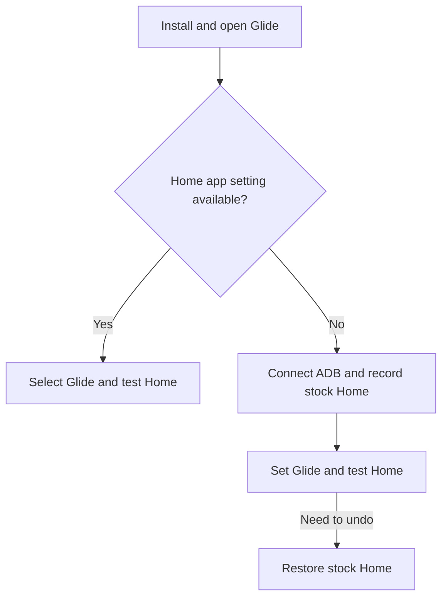

# Make Glide your default Home

Keep your original launcher installed. Menu names and replacement Home support vary by TV firmware.



## 1. Install and try Glide

Follow the [installation guide](INSTALLATION.md). Open Glide and verify that your apps launch.

## 2. Try the TV settings

| What you see | Choose |
| --- | --- |
| **Settings → Apps → Default apps → Home app** | **Glide TV** |
| **Special app access** or **Default launcher** | Look for **Home app**, then choose **Glide TV** |
| A chooser when you press Home | **Glide TV → Always** |

Press Home from inside another app. If the TV still opens its stock launcher, continue below.

## 3. Connect ADB if there is no Home setting

1. In **Settings → System / Device Preferences → About**, select **Build number** seven times.
2. In **Developer options**, enable **USB debugging** and **Wireless debugging** if available.

For TVs with a pairing screen:

```sh
adb pair <tv-ip>:<pairing-port>
# Enter the pairing code shown on the TV.
adb connect <tv-ip>:<debugging-port>
```

Use the two ports shown on the TV. Older TVs may offer direct network debugging or USB instead. Accept the authorization prompt and confirm with `adb devices`.

## 4. Record the original launcher

Run these on your computer, replacing the example serial with the one shown by `adb devices`:

```sh
TV_SERIAL='<your-adb-serial>'
TV_USER="$(adb -s "$TV_SERIAL" shell am get-current-user | tr -d '\r')"
adb -s "$TV_SERIAL" shell cmd package resolve-activity --brief --user "$TV_USER" \
  -a android.intent.action.MAIN -c android.intent.category.HOME
adb -s "$TV_SERIAL" shell cmd package query-activities --brief --user "$TV_USER" \
  -a android.intent.action.MAIN -c android.intent.category.HOME
```

Save the original manufacturer's `package/activity` component from the results before changing anything. If the first command returns a resolver/chooser or Glide is already the default, identify the original TV launcher from the candidate list. Do not treat Android's resolver, System UI, Settings, or a setup wizard as your old launcher.

```sh
STOCK_HOME='<original.launcher.package/original.HomeActivity>'
printf '%s\n' "$STOCK_HOME" > previous-home.txt
```

Keep that file and the list of any components you disable in the next step.

## 5. Set Glide using ADB

```sh
adb -s "$TV_SERIAL" shell cmd package set-home-activity --user "$TV_USER" \
  space.glidetv.launcher/.HomeActivity
adb -s "$TV_SERIAL" shell am start -a android.intent.action.MAIN -c android.intent.category.HOME
adb -s "$TV_SERIAL" shell cmd package resolve-activity --brief --user "$TV_USER" \
  -a android.intent.action.MAIN -c android.intent.category.HOME
```

The resolved component should be `space.glidetv.launcher/.HomeActivity`. Test the physical Home button from another app, then restart the TV and test again.

## 6. If the physical Home button still opens the stock launcher

Some firmware intercepts the remote's Home button even after changing Android's default. First confirm Glide opens explicitly:

```sh
adb -s "$TV_SERIAL" shell am start -n space.glidetv.launcher/.HomeActivity
```

If you choose to override the stock Home activity, keep ADB connected and use only the specific stock launcher component you recorded:

```sh
adb -s "$TV_SERIAL" shell pm disable --user "$TV_USER" "$STOCK_HOME"
adb -s "$TV_SERIAL" shell cmd package set-home-activity --user "$TV_USER" \
  space.glidetv.launcher/.HomeActivity
adb -s "$TV_SERIAL" shell am start -a android.intent.action.MAIN -c android.intent.category.HOME
```

Keep ADB connected. Disable only the stock Home activity you saved. If you can’t select Glide reliably, restore the original Home below.

## 7. Restore the original Home

With the same ADB connection and saved component:

```sh
adb -s "$TV_SERIAL" shell pm enable --user "$TV_USER" "$STOCK_HOME"
adb -s "$TV_SERIAL" shell cmd package set-home-activity --user "$TV_USER" "$STOCK_HOME"
adb -s "$TV_SERIAL" shell am start -a android.intent.action.MAIN -c android.intent.category.HOME
```

Re-enable any additional components you explicitly disabled. The repository's helper performs the same restoration:

```sh
./restore-tv.sh "$TV_SERIAL" "$STOCK_HOME"
# Additional recorded Home components can be supplied as more arguments.
```

The restore script does not uninstall Glide, erase settings, or change unrelated services. Firmware updates may reset launcher preferences; use your saved component list when checking the setup again.
