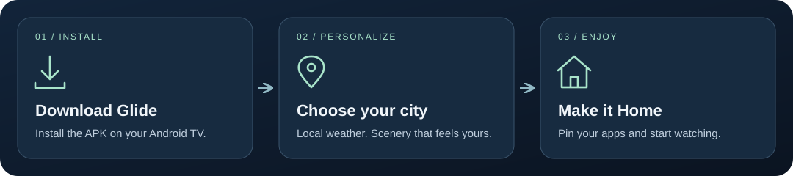
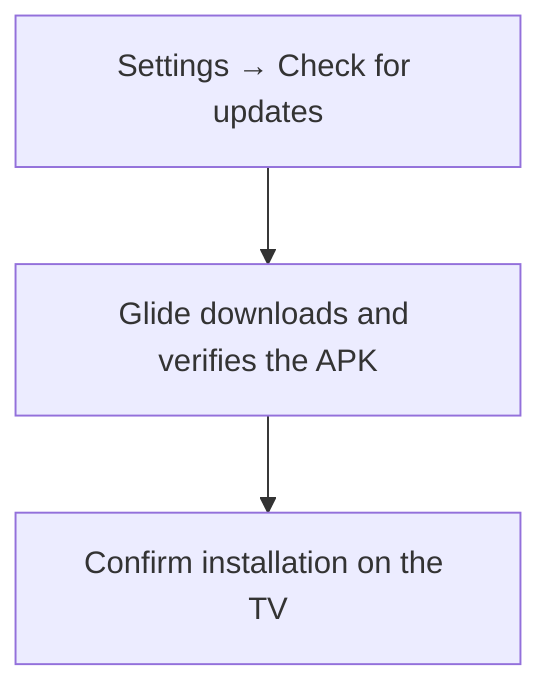

# Install and update GlideTV

**Requires Android TV or Google TV 8.0+ (API 26).**



1. Download `GlideTV.apk` from [Releases](https://github.com/ghanta1996/GlideTV/releases/latest). Sideload it with your preferred installer or ADB.
2. Open Glide and use device location or search for a city/postal code. Weather and scene downloads require internet.
3. [Set Glide as Home](DEFAULT_HOME.md) if supported by your TV, then pin favorites from the app library.

```sh
adb -s "$TV_SERIAL" install -r GlideTV.apk
```

Set `TV_SERIAL` to the TV's serial from `adb devices`.

| Optional permission | Enables |
| --- | --- |
| Location | Automatic local weather and scenery. Manual city search is also available. |
| TV listings / Watch Next | Continue Watching from apps that share it |
| Bluetooth | Bluetooth connection status |
| Notification access | Optional active media title, artist, album and artwork. Glide reads this only while Home is visible, keeps no listening history and provides no playback controls. Availability depends on the app and TV firmware. |

## Install with Downloader

Enter **`3583851`** in Downloader or Glide’s **Apps → Downloader** field. [Short download link](https://aftv.news/3583851) · [Registration details](https://aftv.news/3583851+)

## Updates



Glide verifies the checksum, package and version. Android checks the signing key. Normal upgrades preserve favorites and settings.

| When | What happens |
| --- | --- |
| v4.5.0 and later | Home checks on launch and at most every six hours while active. Failed checks retry after 15 minutes. |
| An update is available | Select **Glide update available** on Home to start. |
| Earlier versions | Use **Check for updates** manually. |

[Direct APK download](https://github.com/ghanta1996/GlideTV/releases/latest/download/GlideTV.apk) · [Install from the phone remote](REMOTE.md)
