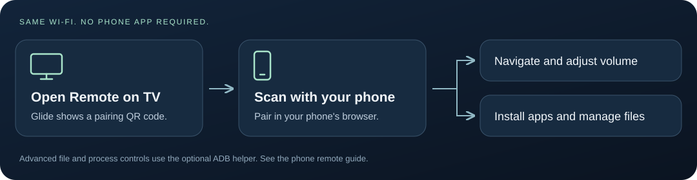

# Phone remote

Use a trusted local network. Put the phone and TV on the same Wi-Fi.



| If you want to… | Do this |
| --- | --- |
| Pair | Open **Remote** or **Settings → Mobile control**. Scan the QR, or enter the address and PIN shown on TV. Green means paired. |
| Install a file from your phone | **Apps → Install APK** → choose a file → confirm on TV. If prompted, grant install permission and tap **Retry installation**. |
| Use a Downloader code or link | **Apps → Downloader** → enter the code or direct public HTTPS APK URL → **Download APK** → **Install on TV**. Grant permission if prompted, then tap **Install on TV** again. |
| Browse shared files or manage running apps | Start the optional ADB helper below. The helper also enables global key input. |
| End a session | Select **Turn off**. If Android closes Glide in the background, reopen Glide and start Remote again. |

| Limits | Details |
| --- | --- |
| APK download | Up to 1 GB. Supports direct APKs or AFTVnews codes. You can cancel a download. |
| File upload | Up to 2 GB per file in `Download/Glide Remote`. Existing files and app-private directories are protected. |
| Pairing | PIN expires after 10 minutes. Session expires after 30 minutes or stops after 5 minutes of inactivity. Status polling does not count as activity. |
| Network | Remote uses local HTTP. Keep its ports off the public internet. |

## Optional ADB helper

Requires **ADB and zsh**. The helper listens on `127.0.0.1` and uses an app-generated token.

Open Glide and its RAM dialog or Remote once to create the token. After building from source:

```sh
./start-memory-helper.sh <adb-serial>
```

Or download `glide-memory-helper.dex` from the same release, download the source scripts, and use:

```sh
GLIDE_HELPER_DEX=/path/to/glide-memory-helper.dex ./start-memory-helper.sh <adb-serial>
```

Restart the helper after rebooting the TV.
