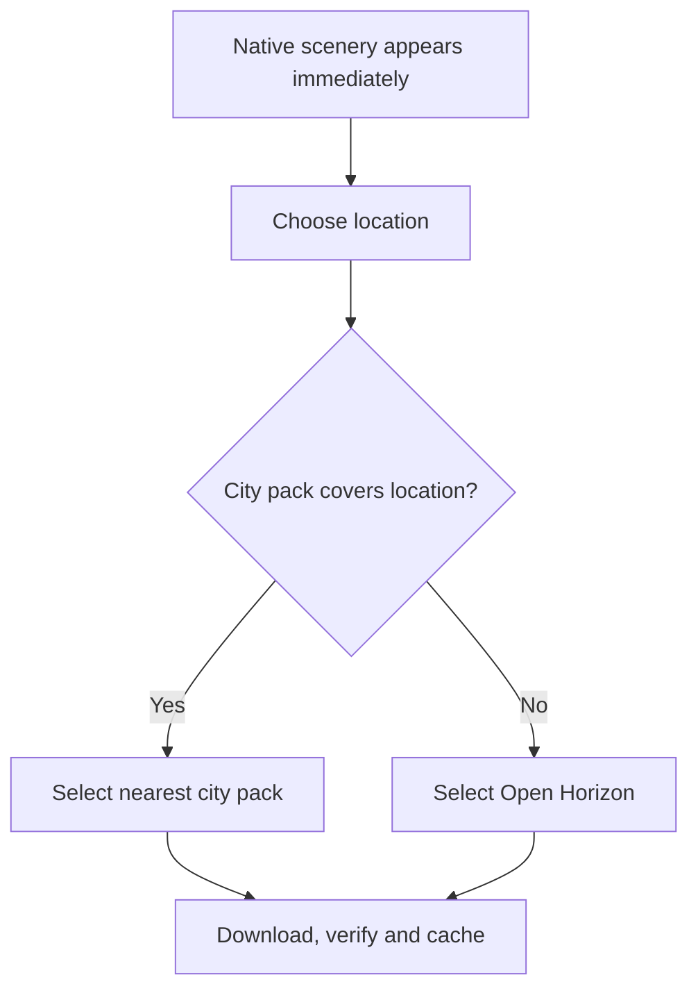

# Downloadable scenes



Glide keeps artwork outside the APK. Cached scenes work offline. Abu Dhabi has a dedicated pack. **Settings → Location & scenery → Refresh downloaded scenery** checks for updates manually.

| File | Role |
| --- | --- |
| [catalog.json](catalog.json) | Maintainers edit pack definitions here |
| [Public catalogue](https://github.com/ghanta1996/GlideTV/releases/download/scene-catalogue/scenes.json) | CI publishes scene metadata and checksums as a release asset |
| [index.json](index.json) | Legacy snapshot used by app versions through 4.5.0 |

The catalogue asset is updated on the `scene-catalogue` release, which is never marked as the latest app release. Generated data does not write to protected `main`. Upgrade to Glide 4.5.1 or later to receive future catalogue updates; older apps keep using the legacy snapshot and cached scenes.

## Versions

| Version | Example |
| --- | --- |
| APK tag and increasing Android version code | `v4.4.0` |
| Catalogue tag matching `catalogVersion` | `scene-v1.0.0` |
| Individual pack semantic version | `1.0.0` |
| Catalogue schema | `schemaVersion: 1` |

Once a pack version is published, its bytes are immutable. The packager compares checksums against the live index and rejects changed content using an existing pack version. Increase the relevant pack version when changing artwork or its rendering kind. Increase the catalogue version for new coverage, pack versions, or selection changes. Record both in [CHANGELOG.md](CHANGELOG.md).

The APK release workflow can publish the current catalogue along with an app release. The separate Scene Packs workflow can publish a new catalogue and pack archives without rebuilding or updating the APK. Scene-only releases are not marked as GitHub's latest app release, so they cannot confuse the in-app APK updater.

## Add a pack

1. Add day/night panoramas and a cloud PNG to the repository, with generation prompts and asset provenance where relevant. City assets must share the same geometry for blending.
2. Add an entry in `catalog.json` with an ID, semantic version, title, `kind: city`, coverage coordinates/radius, and the `city.png`, `city-night.png`, and `cloud.png` source paths.
3. Use `kind: landscape` with a cloud texture for a native terrain scene. Keep exactly one catalogue fallback.
4. Keep images within 8192×4096 and 12 million pixels per image. Downloads are limited to 32 MB compressed and 80 MB expanded. The only supported archive entries are the named PNGs and generated `pack.json`.
5. Update the catalogue version and changelog, then preview packaging:

   ```sh
   python3 scripts/package-scenes.py --tag scene-v1.0.0
   ```

6. Commit and push a matching `scene-v<catalogVersion>` tag. Actions publishes archives, checksums, release notes, and the generated public index.

No API key is needed for pack downloads. Coordinates are used locally to choose a pack; GitHub receives the catalogue and chosen pack requests, rather than a latitude/longitude query. Weather/geocoding requests go to Open-Meteo, and optional Android reverse geocoding uses the TV's configured geocoder.

